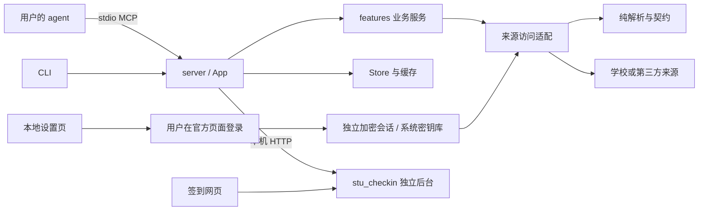

# 架构与产品边界

STU MCP 是面向汕头大学学生的本地校园工具。标准 stdio MCP 是主要接入方式，CLI 提供安装、诊断和无 MCP 环境的补充入口；分析、总结与模型调用由用户自己的 agent 完成。同一实现服务各客户端，不维护互不相通的客户端专版。

本仓库是独立开源产品；Hermes 上的私有 `school_hub` 是另一个部署，不由本仓库运行或修改。仓库不包含原项目历史、运行数据库、个人画像、登录态、Hermes 运行目录或部署配置。

## 模块

| 边界 | 模块与职责 |
| --- | --- |
| 产品入口 | `server` 声明 MCP 工具；`cli` 声明命令；`app` 连接查询、刷新与存储。来源字段解析不放在工具层 |
| 功能与服务目录 | `sources` 声明功能、目标地址和认证依赖；`services` 区分业务用途、校区与来源证据。用途核验、即时可用性、表单和提交验收分别记录 |
| 来源功能包 | `features/repair`、`notices`、`mystu`、`jw`、`yuketang`、`charging`、`huyou` 分别拥有该领域的契约、纯解析、访问与业务编排 |
| 课表文件生成 | `features/timetable/export.py` 是已核对输入到课次及 CSV/ICS 的唯一核心；技能脚本只选择并调用该核心，不请求学校或外部日历 |
| 共用采集类型 | `parsing`、`collection`、`pagination` 提供纯函数、结果类型和保守完整性判定，不依赖来源功能包 |
| 兼容入口 | `parsers`、`collectors`、旧 `repair*`、`charging`、`huyou` 等保留 Python 导入与原注入点，转发功能包；功能包不反向依赖这些门面 |
| 网络传输 | `network` 负责限定主机、HTTPS、显式教务 HTTP 兼容、会话范围、读取预算和脱敏错误；连接池、失败冷却与受限匿名重试见[访问策略](network.md) |
| 连接诊断 | `access_policy`、`connectivity` 按服务及认证依赖检查匿名响应头、DNS和显式代理对照；`network_audit` 检查固定登记的第一方入口。不改配置，不作为普通采集的全量前置条件 |
| 本机状态 | `runtime` 定义用户目录；`vault` 使用系统密钥库保护来源独立会话；`store` 保存缓存与来源范围。`charging_cache` / `charging_devices` 保持公开设备快照、租约与目录政策 |
| 登录与安装 | `auth`、`webvpn`、`setup_web` 负责官方登录与本地设置；`clients` 保留配置、备份、预览和幂等接入；`skill_export` 提供可选技能资源归档 |
| 签到后台 | `checkin` 是本机控制客户端，`checkin_process` 负责独立启动；`stu_checkin` 随包分发后台、网页、监听、结果与加密状态。两页面共用回环 HTTP，绑定时不反向查 DNS |

分层的依赖方向与学校改版维护步骤集中在[来源适配](source-adapters.md)。当前架构写在本文，历次迁移、兼容比对和测试证据保留在[验证记录](verification.md)，不在模块说明里累积批次历史。

## 报修模块的分层

七项报修 MCP 工具和旧 Python 入口保持兼容，CLI 只做草稿和演练。`RepairService` 通过 `RepairSession` 接口使用学校浏览器适配器；业务流程不操作 DOM 或导入 Playwright。

| `features/repair/` 文件 | 职责 |
| --- | --- |
| `__init__.py` | 默认组装；测试可注入内存会话 |
| `models.py` | 业务字段、捕获结果类型和会话接口 |
| `service.py` | 草稿、窗口生命周期、预览时效、命令队列和重复提交保护 |
| `schema.py` | 系统地址、字段、列名、状态词和 DOM 提取契约 |
| `parser.py` | 从提取结果形成业务数据，不访问网络或浏览器 |
| `adapter.py` | 新鲜直连预检、临时浏览器、路由限制、登录等待、填写与回读 |
| `submission.py` | 一次精确匹配的 POST；未知结果不重试 |
| `receipt.py` | 有预算的列表/详情读取、初次创建证明与后续只读刷新 |

读取允许已知的增列、换序和容器变化，身份或字段歧义明确失败。写入需要更严格的控件、字段、目标与方法契约，不猜选择器或备用报修系统。初次查单匹配新增记录和全部原始业务值；确认创建后按固定详情及单号刷新，允许学校更新预约和状态。旧回执及其核查时间在刷新失败时保留。

用户必须看到实际完整表单并明确确认后才能发送一次；发送机会在网络 I/O 前消耗，未知结果只读恢复。完整业务、安全与状态语义由[报修流程](repair.md)维护；测试分为纯解析、内存会话、离线浏览器/回环 HTTP 和真实业务证据。

## 通知与课程适配的分层

`features/notices` 管官网通知、服务目录、OA 列表与正文附件；`features/mystu` 管课程、活动、个人日程和 ELC 作业详情。学校原始字段在适配边界归一化，服务使用解析后的记录。旧采集入口仍显式传入 HTTP / 受保护读取依赖，旧解析函数的名称和参数保留。

正文新鲜度、作业详情是否成功与课程快照是否完整是不同事实；失败不能制造空结果或授权清理未知范围。共同规则见[数据与失败语义](source-adapters.md#数据与失败语义)。

## 教务成绩与考试的分层

`features/jw` 分离表格/学期契约、纯解析、访问与部分失败编排。表格和同义列必须唯一，明确空表与结构失败分开；成绩失败保留旧缓存，考试失败不丢弃本轮正常成绩。旧入口、记录 ID、字段、数值转换和缓存版本保持兼容。表格、学期、传输和登录证明的维护细节见[教务适配](academic.md)。

## 雨课堂课程查询的分层

`features/yuketang` 分离 JSON 契约、纯解析、固定 API 与课程编排。每课活动与公告各有独立失败边界；活动完整性决定该课旧任务是否可清理，公告不参与快照删除。字段、原生学期、分页、限额和请求预算见[雨课堂适配](yuketang.md)。独立 `yuketang_readiness` 只做作业结构诊断，不增加主查询链工具或答题行为。

## 第三方来源与后续课表

充电与狐友采用相同分层，但维持各自匿名访问、签名、预算和缓存政策；不使用学校账号或会话。充电设备租约与狐友讨论合并不并入公共校园记录。具体维护契约见[第三方适配](third-party-adapters.md)，用户行为见[充电查询](charging.md)和[狐友查询](huyou.md)。

课表来源、事件展开与目标格式是独立边界。现有课程库存和短期日程不代表完整学期；技能组织取证与审阅，本地核心只转换已经核对的输入。当前能力、可选资源包和后续学校取数条件集中在[学期课表](timetable.md)。

## 认证依赖

公开来源无需账号；OA 先匿名读取，受保护访问才使用可选 WebVPN。只允许 HTTPS 认证代理，不向旧 HTTP 代理发 cookie。教务与 MySTU 各自完成学校统一认证；雨课堂在自己的官方页面登录，扫码不赋予读取微信消息的能力。系统目录和真实核验范围见[校园协议](campus-protocols.md)。

默认登录由用户在官方交互页面完成，各来源独立加密保存会话，不要求全量 `.env` 或模型密钥。WebVPN 自动重登需本人在本机设置页启用；账号、密码和 TOTP 密钥只进系统密钥库。重登仅在 OA 受保护读取时触发，一轮读取至多一轮，进程间串行且失败冷却；拒绝或人工挑战会暂停，不自动绑令牌或保活。

手动与自动登录都核对来源会话代次。退出写随机代次标记，阻止尚未提交的旧登录任务恢复旧账号；配置、保存和缓存提交分别核对版本，避免覆盖另一账号的新会话及缓存。各来源缺少认证只影响自己的读取。设置及兼容选项见[安装登录](install.md)。

教务登录入口和查询接口分别声明；不能因匿名重定向推断整套查询下线。`jw_http_compat` 是本机默认关闭的显式选项，不接受 MCP 参数；密码只发 HTTPS SSO，成绩和考试从 HTTPS 发起，登录证明只读可识别学生主页。传输事实记录为 `https` 或 `school_legacy_http`，详见[教务适配](academic.md)。

## 数据与范围

查询默认使用缓存，刷新按需发起，每条记录保留来源和采集时间。刷新范围、部分失败、正文与课程快照规则由[来源适配](source-adapters.md#数据与失败语义)统一维护。报修确认、对分易签到和普通只读采集各有业务边界，不因共用 MCP 入口而获得额外写入授权。

对分易由用户明确启动，是会向平台提交签到的独立持续任务；MCP 和网页共享该后台的单实例、控制接口、状态与结果。关闭 MCP 不停止已授权后台，显式暂停取消恢复计划。充电仍由 MCP 直接访问平台，不依赖网页或签到进程。运行细节见[对分易后台](checkin.md)。
