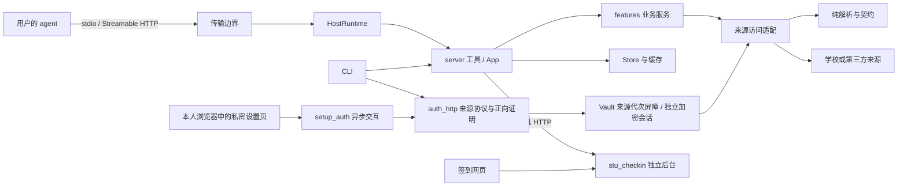

# 架构与产品边界

STU MCP 是面向汕头大学学生的校园工具。桌面默认使用 stdio，个人服务器可通过 Streamable HTTP 复用同一实例；CLI 提供安装、更新、诊断和补充入口。分析、总结与模型调用由用户自己的 agent 完成。同一实现服务各客户端，不维护客户端或服务器专版。部署与验证边界见[服务器说明](server.md)。

本仓库是独立开源产品；Hermes 上的私有 `school_hub` 是另一个部署，不由本仓库运行或修改。仓库不包含原项目历史、运行数据库、个人画像、登录态、Hermes 运行目录或部署配置。

本文描述 v0.7.1 待发布源码的 `capability_catalog`、`login school` 与私密网页 HTTP 交互，原有来源、工具和单业务认证继续兼容。源码结构、离线测试、真人认证和发行验收分别记录。

## 模块

| 边界 | 模块与职责 |
| --- | --- |
| 产品入口 | `server` 声明 MCP 工具；`cli` 声明命令；`app` 连接查询、刷新与存储。来源字段解析不放在工具层 |
| 实例与接入 | `hosting.HostRuntime` 组装一个人的服务与生命周期；`transports/http` 只处理私有鉴权、入口约束与 SDK 的 HTTP 传输。HTTP 客户端共用一个实例，断开连接不关闭实例，不为每个请求重建 App |
| 功能与服务目录 | `sources` 声明八个已适配来源、目标地址和认证依赖；`services` 区分业务用途、校区与来源证据。`capability_catalog` 维护配置组、现有工具和具体业务接入范围，投影已读取本地状态，供 App、宿主与设置页共用；不扩展来源、网络或认证白名单 |
| 来源功能包 | `features/repair`、`notices`、`mystu`、`jw`、`yuketang`、`charging`、`huyou`、`takeout` 分别拥有该领域的契约、纯解析、访问与业务编排 |
| 课表文件生成 | `features/timetable/export.py` 是已核对输入到课次及 CSV/ICS 的唯一核心；技能脚本只选择并调用该核心，不请求学校或外部日历 |
| 共用采集类型 | `parsing`、`collection`、`pagination` 提供纯函数、结果类型和保守完整性判定，不依赖来源功能包 |
| 兼容入口 | `parsers`、`collectors`、旧 `repair*`、`charging`、`huyou` 等保留 Python 导入与原注入点，转发功能包；功能包不反向依赖这些门面 |
| 网络传输 | `network` 负责业务来源范围、HTTPS、各自显式的教务/OA HTTP 兼容与固定一卡通 HTTP 范围、读取预算和脱敏错误；`auth_http/transport` 负责认证直连、一次提交及独立预算。策略见[访问说明](network.md) |
| 连接诊断 | `access_policy`、`connectivity` 按服务及认证依赖检查匿名响应头、DNS和显式代理对照；`network_audit` 检查固定登记的第一方入口。不改配置，不作为普通采集的全量前置条件 |
| 宿主状态 | `runtime` 定义数据目录；`credentials` 选择系统密钥库或显式外置主密钥后端；`vault` 保护来源独立会话；`store` 保存缓存与来源范围。`charging_cache` / `charging_devices` 保持公开设备快照、租约与目录政策 |
| 登录与安装 | `auth_http` 分离共享传输、CAS/平台协议和 Vault 保存编排；`auth_http/school` 一次接收凭据，按选择调用独立认证并核对整组退出屏障，不持久保存普通密码。真实 TTY 与私密网页以显式交互适配器共用此核心，`terminal` 不接受管道，网页不模拟 TTY。`webvpn` 管可选凭据与按需重登，`checkin_login` 复用原回调；`auth` 保留显式 Playwright 兼容。`clients/skill_export` 管幂等接入与资源归档 |
| 本人网页交互 | `setup_web` 保护回环 Host/Origin、页面令牌与私密 API；`setup_auth` 仅管共享 HTTP 核心的有界异步任务、输入/二维码挑战及取消。网页按五类配置组织，学校组统一编排；WebVPN 复用既有安全配置和 TOTP 实现。移除旧浏览器调度器及独立传输/自动重登配置路由。MCP 只触发打开页面，不传递页面 capability URL、凭据或扫码内容 |
| 更新 | `updates` 统一官方发行查询、下载校验与升级结果；`update_install` 识别 uv 安装并调用安装器，`update_guard` 阻止并发升级和活动报修冲突。CLI 与 MCP 共用实现；不依赖学校认证、修改客户端配置或自动重启进程 |
| 签到后台 | `checkin` 是本机控制客户端，`checkin_process` 负责独立启动；`stu_checkin` 随包分发后台、网页、监听、结果与加密状态。两页面共用回环 HTTP，绑定时不反向查 DNS |

分层的依赖方向与学校改版维护步骤集中在[来源适配](source-adapters.md)。当前架构写在本文，历次迁移、兼容比对和测试证据保留在[验证记录](verification.md)，不在模块说明里累积批次历史。

入口整理以[配置→可用功能、学校服务→接入缺口](campus-services.md)两种视图为主。当前源码的统一目录引用已有来源、工具与登录 ID，给 `App.status()`、`HostRuntime.capabilities()` 新增 `capability_catalog`，原返回字段与已有工具接口保留，新增课表及两项一卡通查询后共 50 项。设置页据 `profiles` 展示汇总配置状态与功能，据 `services` 展示异常和接入缺口。宿主复用一次被动签到状态读取；CLI 状态未检查 worker 时明确未知，不为展示能力启动后台。

目录是纯元数据与状态投影：保存会话、本地后台事实、历史刷新与当前访问分别呈现；当前网络和业务读取保持 `not_checked`，用途证据保留原日期。`implemented` 不等于当前在线可用，`navigation_only` 或 `not_integrated` 不因账号配置而解锁。同一主机的课程/预约、公开馆藏/个人借阅分别登记；发现入口不会注册为登录来源、探测目标或请求许可。

## 报修模块的分层

七项报修 MCP 工具和旧 Python 入口保持兼容。`RepairService` 通过 `RepairSession` 接口默认使用直连 HTTP WebForms；CLI 也可展示预览并在本人确认后提交一次。旧工具名中的 form/window 保留兼容语义，不代表默认创建浏览器。业务服务不操作 DOM 或导入 Playwright。

| `features/repair/` 文件 | 职责 |
| --- | --- |
| `__init__.py` | 默认组装 HTTP 会话；测试可注入内存会话 |
| `models.py` | 业务字段、捕获结果类型和会话接口 |
| `service.py` | 草稿、窗口生命周期、预览时效、命令队列和重复提交保护 |
| `schema.py` | 系统地址、字段、列名、状态词和 DOM 提取契约 |
| `parser.py` | 从提取结果形成业务数据，不访问网络或浏览器 |
| `http_adapter.py` / `http_parser.py` | 独立 repair 会话、固定地址、WebForms 隐藏状态及预约回发、实际值回读和回执读取；解析与 I/O 分开 |
| `adapter.py` | 保留显式浏览器兼容，不是默认认证/填写路径 |
| `cli.py` | 同一服务的本人终端演练、完整预览和精确确认，不经 MCP 接收凭据 |
| `submission.py` | 一次精确匹配的 POST；未知结果不重试 |
| `receipt.py` | 有预算的列表/详情读取、初次创建证明与后续只读刷新 |

读取允许已知的增列、换序和容器变化，身份或字段歧义明确失败。写入需要更严格的控件、字段、目标与方法契约，不猜选择器或备用报修系统。初次查单匹配新增记录和全部原始业务值；确认创建后按固定详情及单号刷新，允许学校更新预约和状态。旧回执及其核查时间在刷新失败时保留。

用户必须看到实际完整表单并明确确认后才能发送一次；发送机会在网络 I/O 前消耗，未知结果只读恢复。完整业务、安全与状态语义由[报修流程](repair.md)维护；测试分为纯解析、内存会话、离线浏览器/回环 HTTP 和真实业务证据。

## 通知与课程适配的分层

`features/notices` 管官网通知、服务目录、OA 列表与正文附件；`features/mystu` 管课程、活动、个人日程和 ELC 作业详情。学校原始字段在适配边界归一化，服务使用解析后的记录。旧采集入口仍显式传入 HTTP / 受保护读取依赖，旧解析函数的名称和参数保留。

正文新鲜度、作业详情是否成功与课程快照是否完整是不同事实；失败不能制造空结果或授权清理未知范围。共同规则见[数据与失败语义](source-adapters.md#数据与失败语义)。

## 教务成绩、考试与理论课表的分层

`features/jw` 分离表格/学期契约、纯解析、访问与部分失败编排。表格和同义列必须唯一，明确空表与结构失败分开；成绩失败保留旧缓存，考试失败不丢弃本轮正常成绩。旧入口、记录 ID、字段、数值转换和缓存版本保持兼容。表格、学期、传输和登录证明的维护细节见[教务适配](academic.md)。

当前源码的理论课表沿用同一 JW 适配器，独立纯解析放在 `features/jw/timetable.py`，CLI 与 MCP 共用按需读取服务。结果只驻留本次调用；读取前后核对会话代次，不增加数据表或同步任务。课程／安排字段直接兼容已有导出模型，未排课和待核实项显式返回。

## 雨课堂课程查询的分层

`features/yuketang` 分离 JSON 契约、纯解析、固定 API 与课程编排。每课活动与公告各有独立失败边界；活动完整性决定该课旧任务是否可清理，公告不参与快照删除。字段、原生学期、分页、限额和请求预算见[雨课堂适配](yuketang.md)。独立 `yuketang_readiness` 只做作业结构诊断，不增加主查询链工具或答题行为。

## 第三方来源与课表转换

充电与狐友采用相同分层，但维持各自匿名访问、签名、预算和缓存政策；不使用学校账号或会话。充电设备租约与狐友讨论合并不并入公共校园记录。具体维护契约见[第三方适配](third-party-adapters.md)，用户行为见[充电查询](charging.md)和[狐友查询](huyou.md)。

课表来源、事件展开与目标格式是独立边界。理论课表读取只负责周次安排；技能组织最新校历、作息和完整性的取证与审阅，唯一的本地核心继续转换已核对输入。现有课程库存和短期日程保持原有语义。当前能力、可选资源包和扩展条件集中在[学期课表](timetable.md)。

## 认证依赖

各模块的真实入口、成功证明、持久化、退出和服务器审查结果集中在[认证基线](authentication.md)。修改前先沿源码调用链核实；官网新登录方式、匿名技术研究与已接入能力分别记录。

公开来源无需账号；OA 先匿名，受保护访问才使用 WebVPN。普通学校/CAS 密码和 TOTP 只用 HTTPS；独立一卡通查询密码仅在本人授权的固定官方 HTTP 登录中使用，细节见[一卡通边界](smartcard.md)。学校目录指定的 OA HTTP 8118 仅在本人单独开启兼容后允许该来源会话，不能自动降级。教务与 MySTU 分别完成 CAS；雨课堂通过官方二维码和本人手机确认，不读取微信消息。系统目录及历史证据见[校园协议](campus-protocols.md)。

默认登录使用 HTTP 适配器，各来源独立加密保存会话。本人可在真实宿主终端或私密设置页输入；网页是同一核心的交互适配器，不启动服务端浏览器或虚拟桌面。CLI 保留业务选择、重新认证和教务兼容参数；学校账号网页连接全部已接入业务，内部仅使用固定教务回调，不改变全局传输偏好。已有同账号会话仅本地跳过，不作在线 proof。适配器返回内存 Candidate，编排层核对正向 proof、来源代次及取消后保存。WebVPN 表单可直接接收已有令牌密钥，复用安全配置和 TOTP 实现验证登录；账号、密码和密钥只进受保护后端。后续按需重登一轮读取至多一轮，进程间串行且失败冷却；拒绝或人工挑战暂停，不绑令牌或保活。

手动与自动登录都核对来源会话代次。退出写随机代次标记，阻止尚未提交的旧登录任务恢复旧账号；配置、保存和缓存提交分别核对版本，避免覆盖另一账号的新会话及缓存。统一账号编排还核对全部所选业务代次，以及本次保存返回的密文指纹，不能采纳并发退出后同账号的另一份新会话；遇拒绝、挑战或未知发送结果停止后续共享密码尝试。各来源缺少认证只影响自己的读取。设置及兼容选项见[安装登录](install.md)。

教务登录入口和查询接口分别声明；不能因匿名重定向推断整套查询下线。`jw_http_compat` 是本机默认关闭的显式选项，不接受 MCP 参数；密码只发 HTTPS SSO，成绩和考试从 HTTPS 发起，登录证明只读可识别学生主页。传输事实记录为 `https` 或 `school_legacy_http`，详见[教务适配](academic.md)。

## 数据与范围

查询默认使用缓存，刷新按需发起，每条记录保留来源和采集时间。刷新范围、部分失败、正文与课程快照规则由[来源适配](source-adapters.md#数据与失败语义)统一维护。报修确认、对分易签到和普通只读采集各有业务边界，不因共用 MCP 入口而获得额外写入授权。

对分易由用户明确启动，是会向平台提交签到的独立持续任务；MCP 和网页共享该后台的单实例、控制接口、状态与结果。关闭 MCP 不停止已授权后台，显式暂停取消恢复计划。充电仍由 MCP 直接访问平台，不依赖网页或签到进程。运行细节见[对分易后台](checkin.md)。
