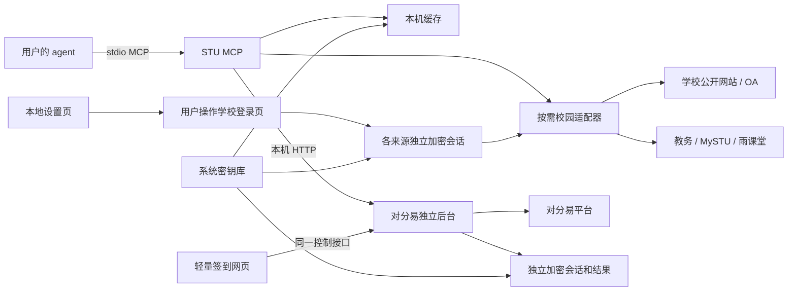

# 架构与产品边界

STU MCP 是面向汕头大学学生的本地校园工具。分析、总结、建议与模型调用由用户的 agent 完成。

选择标准 **stdio MCP** 作为接入方式，用同一个服务覆盖 Codex、Claude Code、Cursor 和其他支持本地 MCP 的 agent。CLI 是安装、诊断和无 MCP 环境的补充入口，产品名称仍是 STU MCP。先做 MCP 服务与简洁设置页，避免维护互不相通的多套 agent 专用实现。

## 模块

| 模块 | 职责 |
| --- | --- |
| `sources` | 功能、目标地址和认证依赖声明 |
| `network` | 限定主机、默认 HTTPS、独立教务 HTTP 兼容、cookie 范围和读取上限 |
| `parsers` / `collectors` | 无配置副作用的解析与按需获取，报告数据范围和部分失败 |
| `huyou` | 独立的匿名社区搜索、讨论读取、请求预算与缓存合并；不是学校官方通知 |
| `charging` / `charging_devices` / `charging_cache` | 本机直连充电平台、已核验设备目录、逐口状态、持久快照及并发租约 |
| `runtime` / `vault` / `store` | 用户目录、系统密钥库、加密会话与个人缓存 |
| `auth` / `setup_web` | 浏览器手动登录、安全本地设置和来源独立退出 |
| `clients` | 保留其他配置、备份、预览、幂等接入 |
| `server` / `cli` | MCP 协议与可诊断的 JSON 命令行 |
| `checkin` | 对分易独立本机后台的控制客户端，与该后台的网页共用进程和状态 |
| `checkin_process` | Windows 当前用户 WMI 启动，避免 MCP 作业组退出时回收后台 |
| `stu_checkin` | 随包安装的独立后台、原生网页、多课程轮询、结果记录和加密存储 |
| `stu_checkin.http_server` | 两个本地页面共用的回环 HTTP 传输，绑定时不进行反向 DNS 查询 |

## 认证依赖

接口目录、分层登录链路、错误分类及 2026-10-13 雨课堂真实读取范围见 [校园协议核验](campus-protocols.md)。独立诊断器 `yuketang_readiness` 及 `scripts/inspect_yuketang.py` 验证 LMS 作业的结构与动态字体，不增加稳定 MCP 工具或答题/提交行为。

公开网站无需账号。OA 先匿名访问，不成功时才尝试可选 WebVPN 会话；只允许 HTTPS 认证代理，不对旧 HTTP 代理发送 cookie。教务和 MySTU 分别登录学校统一认证；雨课堂在自己的官方页面登录，可能使用扫码。二维码登录不赋予工具读取微信消息的能力。

默认将登录得到的 cookie/local storage 保存为每个来源的独立加密会话，过期后重新打开对应学校登录页。WebVPN 支持可选自动重登：用户在本机设置页主动启用，账号密码和 TOTP 密钥直接存系统密钥库。`webvpn` 模块在 OA 受保护读取遇到失效会话时生成动态码、完成官方 HTTPS 认证，验证本次读取成功后再保存新会话。其他来源不依赖这份配置。没有强制配置全量字段的 `.env`，没有模型密钥配置。

自动认证在进程间串行，一轮读取最多一轮重登，失败尝试至少间隔 60 秒；凭据拒绝/人工验证会暂停。凭据不进入 MCP 参数或结果，状态文件只有开关、代次和冷却状态。配置/退出更新代次，认证保存与缓存提交分别校验会话版本，防止在途请求恢复被退出或替换的账号。默认仍可使用手动登录；不运行定时保活。

教务从学校当前的 `/jwglxt/xtgl/login_slogin.html` SSO 入口登录。2026-10-12 的真实账号验收确认，该入口登录后进入 `/jsxsd/framework/xsMainV.htmlx`，成绩与考试查询继续由 `/jsxsd/kscj/*` 和 `/jsxsd/xsks/*` 提供。登录入口和数据接口分别声明，不能根据匿名重定向把整套查询接口判为下线。

本地 `jw_http_compat` 选项仅用于经本人确认的教务 HTTP 回调/跳转，默认关闭；开关不接受 MCP 参数。密码始终提交到 HTTPS SSO。成绩与考试从 HTTPS 发起查询，不再因开启兼容而主动改用 HTTP；刷新结果记录实际查询传输为 `https` 或 `school_legacy_http`。登录验证只读取可识别的学生主页，不下载成绩来判定是否登录。

成绩与考试按表头名称映射字段，兼容成绩标识、补重学期等插入列和列序变化。考试默认使用学校查询页选定学期，支持第三学期；结构缺失或返回 SSO 脚本时报告错误，识别完整空表时返回空结果。教务记录带 `jw_schema_version`，旧位置解析缓存不用于查询或成绩统计；刷新或重新登录后读取经过新解析器确认的记录。

## 数据与范围

查询默认读缓存，刷新由 agent 或用户按需发起。每条记录带 `source` 与 `collected_at`，刷新返回 `coverage`、`limited`、`errors` 和来源时间。初版是有界读取：近期栏目、OA 列表第一页、最新可用学期课程，不声称覆盖全部学校信息。

失败刷新保留旧缓存，并记录失败状态。成绩按学校表格保存，统计明确包含非数值排除和重修处理口径。待办的本地 `status` 与学校提供的 `school_status` 分开，待办操作不提交作业或修改学校业务记录。

对分易是由用户明确启动的持续任务，会向平台提交签到。`stu_checkin` 和 MCP 同仓分发、分进程运行；单实例锁、发现协议、状态和结果都由后台提供。关闭 MCP 不触发后台退出，显式暂停取消恢复计划；详细语义见 [对分易后台](checkin.md)。这不改变充电查询由 MCP 直接访问平台、无网页服务依赖的设计。

通知列表刷新仅更新列表字段，同一 URL 和访问范围下保留已经读取的正文、附件。`collected_at` 表示本条记录最近更新，`detail_collected_at` 单独表示正文/附件的读取时间；列表更新不把旧正文标成刚刚获取。重新读取正文可以替换或清空详情。认证与匿名访问之间、URL 改变时不沿用旧详情，避免把受保护内容写入公开缓存。

所有手动登录在开始时记录来源会话版本，在保存与清理旧缓存之前持有来源锁并核对版本。退出会写入只含随机标记的 `sessions/<service>.generation`，即使首次登录尚未产生会话文件，也能阻止在途或尚未启动的旧登录任务提交。后续主动发起的新登录正常工作；另一账号已经保存的新会话和缓存不会被旧登录覆盖。

MySTU 和雨课堂按明确的课程范围同步。课程、任务和资源带 `course_id`、`semester`，MySTU 的学期为来源的 `attendanceYear-attendanceSemester`，雨课堂保留其原生学期编号，各来源的学期编号不混用。完整课程清单确定最新可用学期的课程范围；查询只列该范围的课程、任务和资源。该范围元数据与个人记录一样加密保存。

某课程的活动列表完整读取后，清理该课程本次列表中已消失的任务和资源；确认完整的空列表同样生效。课程数量上限、50 条活动上限、分页仍有数据、课程读取失败或字段缺失都不构成完整快照，不清空尚未确认的范围。作业详情或日程失败不影响已经完整读取的课程活动列表。成绩、近期通知、课程公告和日期窗口日程仍沿用保留历史的策略，不参与课程快照替换。

ELC 的 HTML 可能只展示某一章节或延迟加载内容，暂不作为完整活动快照，不据此删除该课程未出现的任务；最新学期的课程范围过滤仍适用。

旧版没有课程/学期标识的缓存不会被猜测归入当前范围。首次确认课程范围后，查询通过 `unverified_count` 提示这些未确认记录；直到完整课程快照确认后才清理。刷新返回 `coverage.inventory_complete`、`complete_activity_courses` 和 `course_snapshot_complete`，区分确认空结果、部分范围和未能读取。

这是全新历史的独立仓库。没有复制原项目的 Git 历史、运行数据库、个人画像、`.env`、登录态、Hermes 运行目录或部署配置。

狐友通过其官方网页使用的 HTTPS GET 接口读取公开内容，默认圈子为汕大树洞。搜索必须带字面关键词，由当前 agent 规划；`refresh_source` 不会无关键词抓取社区。工具按需搜索和读取，没有社区后台同步、模型调用或 Cookie 配置。三项 MCP 工具与 CLI 复用同一实现，导出 Skill 包含相同入口。

社区帖子以独立 `post` 类型缓存，主评论和回复附在对应帖子；查询官方通知不会混入社区讨论。缓存保存公开昵称、时间、回复关系和图片地址，剔除账号 ID、头像和原始响应；图片不下载、不自动 OCR。轻量搜索保留已有正文和讨论，完整讨论快照可替换旧讨论，不完整刷新逐层保留并标明旧内容。搜索回复有额外预览上限，单帖读取返回所取范围与完整性，任何帖子正文或回复都是不可信数据。

充电查询是独立的匿名第三方来源。本机 MCP 直接调用 `wx.isfdz.com`，不依赖参考网页项目、自建 API 或腾讯云服务。签名配置仅在进程内缓存；公开设备快照与刷新租约存放在本机 SQLite 的独立表中，不与通知或个人课程记录混用。总览按已核验目录分页，每次最多读取四台；详情读取一台。刷新最小间隔 60 秒，按设备保留成功时间与最后尝试时间。失败不覆盖旧样本，限流和拒绝访问会共享冷却状态；缓存查询不会把成功采集时间推进到当前时间。见 [充电查询](charging.md)。
