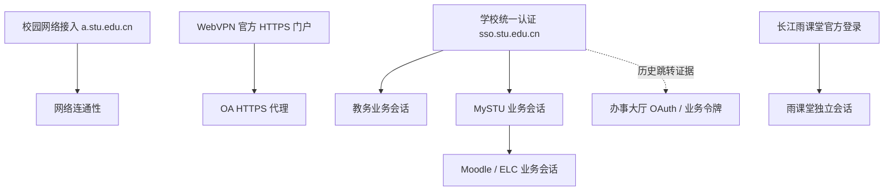

# 校园系统接口、认证与雨课堂读取核验

更新：2026-10-13。本文区分真实读取、公开前端代码、历史材料和待验证推断。不是全校系统的完整接口文档。

本轮保留 19 项 MCP 工具和现有登录 UI；修复错误分类与定位，并提供独立的只读诊断脚本。没有加入答题、提交、开始考试、签到、保活或 Hermes 运行依赖。原 School Hub 和生产服务未修改。

## 证据与可信范围

| 证据 | 能支持的结论 | 限制 |
| --- | --- | --- |
| 用户指定的 Hermes 会话及其关联研究会话、原始工具结果 | 已出现的入口、跳转、请求路径和响应特征 | 历史材料，不等同于当前可用；仅针对指定材料读取，未导出会话数据库 |
| Hermes `RECON_XK11.md` 与后续 `review.md` | 研究线索及对先前报告的纠错 | 不能仅凭版权年份、响应头、500 页面判断版本、厂商或漏洞；这类推断没有进入实现 |
| 原 `yuketang_refresh.py`、会话维护适配器 | 课程/活动的既有 GET 路径与会话错误处理 | 旧脚本和旧健康记录不是本次成功凭证；本轮服务器旧会话的只读请求实际返回 401 |
| 2026-10-13 本机用户交互登录及随后认证 GET | 雨课堂课程、活动、LMS 作业详情与题目列表实际可读 | 限本人已授权账号、已读取的课程与题型 |
| 雨课堂官方前端构建 `1.2.324` | LMS URL 模板、题型枚举、选项字段和资源关联关系 | 静态代码存在不代表每个账号、活动类型都可访问 |
| 0.4.1 验证记录 | 2026-10-12 教务登录、学生主页、成绩、空考试表 | 本轮未重复操作教务、WebVPN、OA 的真实认证流程 |

Hermes 材料校验值：`RECON_XK11.md` SHA-256 `755f088ca87723bf2ebdbc8a6097d9baee78a99394fd8972c290e4fb9fb2fee5`；`review.md` SHA-256 `2821a036ad0b6274e56babfcf20b8b57340886088b7ee88bec9a69a64c8328fc`。原始个人材料留在其所属环境，不随项目分发。现有“逆向手册”目录只有来源摘录，不能当作已完成的系统手册。

## 系统关系与登录链路



校园网络接入、WebVPN、学校统一认证和各业务会话是不同层次。某个系统登录成功，只能证明其被实际探测的业务入口成功；保存 cookie 也不等于会话仍有效。

| 系统 | 入口与链路 | 业务成功的证据 | 当前边界 |
| --- | --- | --- | --- |
| 校园网络接入 | `a.stu.edu.cn/ac_portal/.../pc.html` | 需网络连通性验证 | Hermes 历史线索；未实现适配，不据此判定设备型号或认证协议版本 |
| 统一认证 | `sso.stu.edu.cn/login?service=…` → 对应业务回调 | 回调后的受保护业务读取 | CAS cookie 不能代替业务 cookie；ticket 属于认证信息，不能进入日志或结果 |
| WebVPN | `https://webvpn.stu.edu.cn/portal/#!/service` → HTTPS 代理 | 目标 OA 内容真正可读 | 门户 cookie 仅暂存，不能单独宣告 OA 已可用；手动登录默认，可选自动重登由用户本机启用 |
| OA | 匿名 `oa.stu.edu.cn` 公告列表；受保护内容经 `oa-stu-edu-cn.webvpn.stu.edu.cn` | 可识别的公告列表/正文 | 匿名 HTTP 不携带会话；不使用旧 8118 HTTP 认证代理 |
| 教务 | `/jwglxt/xtgl/login_slogin.html` → SSO → `/jsxsd/framework/xsMainV.htmlx` | 学生主页模块标记；查询按实际表头校验 | 入口与查询后端并存，不把 `jwglxt`/`jsxsd` 视为互斥；真实验证见 0.4.1 记录 |
| MySTU | `/discussion/my-courses` → SSO → MySTU API | `/user/validate` 及课程列表 | API 成功不能证明 ELC 作业页可读 |
| Moodle / ELC | 同一交互浏览器访问 `/courses/elc/`，再访问具体课程/作业 | 课程内容/作业详情可识别 | 当前登录器只做引导与页面检查，仍需具体资源证据；活动密码、权限、登录页必须分开 |
| 办事大厅 | `/taskcenter-v4/` → `/sso/oauth2/authorize` → `/sso/login` → 学校 SSO | 有效业务令牌下的应用接口响应 | 来自 Hermes 历史跳转与前端线索，尚无本轮认证业务验收，不接入 MCP |
| 雨课堂 | `https://changjiang.yuketang.cn/` 官方交互登录 | `/v2/api/web/courses/list?identity=2` 返回可识别课程列表 | 独立会话，当前只适配长江站点；扫码不代表可读取微信消息 |

学校官网/学生处是匿名信息来源；狐友是独立社区来源，不能归入学校统一认证或当作校方政策接口。

## 已知接口目录

路径中的 ID 只从本人已授权列表和关联响应取得。文档使用模板，不包含真实学生、课程、作业标识或认证参数值。

| 系统 | 方法、路径 | 用途与校验 |
| --- | --- | --- |
| 官网/学生处 | GET `/xwzx/zxyw.htm`、`/xwzx/zhxw.htm`、`/xwzx/hdyg.htm`、`/NoticeList.aspx?NewsTypeID=3` | 匿名有界列表；文章链接结构与主机校验 |
| OA | GET `/login/Login.jsp?logintype=1`，跟随已解析的公告/附件链接 | 表格/正文结构可识别才成功；受保护请求仅 HTTPS 代理 |
| 教务 | GET `/jsxsd/framework/xsMainV.htmlx` | 登录探测，不用下载成绩判定登录 |
| 教务 | POST `/jsxsd/kscj/cjcx_list`，表单 `kksj,kcmc,kcxz,kspage,jspage` | 查询成绩的表单请求，最多 200 行，按表头解析；这是查询，不是提交学业记录 |
| 教务 | GET `/jsxsd/xsks/xsksap_query`；POST `/jsxsd/xsks/xsksap_list`，表单 `xnxqid,xqlb,xqlbmc` | 先读取学校选定学期，再查询考试；表格缺失不能当作零条考试 |
| MySTU | GET `/v3/services/api/user/validate?ver=1.1` | MySTU API 会话探测 |
| MySTU | GET `/v3/services/api/course/query` | 支持 `fields` + 数组行；取最新可识别 `attendanceYear/attendanceSemester` |
| MySTU | GET `/v3/services/api/courseactivity/query?moodleCourseId={id}&category=undefined&lang=zh-CN` | 课程活动清单；含作业链接不表示已取得详情 |
| MySTU | GET `/v3/services/api/userschedule/query?startTime={ms}&endTime={ms}&category=all` | 过去 7 天至未来 31 天日程；失败不拖累课程结果 |
| ELC | GET 清单中已有的 `/courses/elc/course/view.php`、`/mod/assign/view.php`、`/mod/quiz/view.php` | 读取课程或活动页面；时间/提交状态按页面字段解析，不开始测验或提交表单 |
| 雨课堂 | GET `/v2/api/web/courses/list?identity=2` | `errcode` + `data.list`；最新可用 `term`，不将原生学期编号转换为 MySTU 格式 |
| 雨课堂 | GET `/v2/api/web/logs/learn/{classroom_id}?actype=-1&page=0&offset=50&sort=-1` | `data.activities/has_more`；最多 50 条，列表不完整不清理未读缓存 |
| 雨课堂 | GET `/v/discussion/v2/announcements/?cid={classroom_id}&limit=20&offset=0&type=9` | 课程公告，独立于活动读取处理错误 |
| 雨课堂 | GET `/api/v3/classroom/on-lesson-upcoming-exam` | 课堂/考试入口的只读探测；本次两个列表均为空，不进入任何考试 |
| 雨课堂 LMS | GET `/mooc-api/v1/lms/learn/leaf_info/{classroom_id}/{leaf_id}/?classroom_id={classroom_id}` | 关联作业 `content_info.leaf_type_id` 与 `sku_id`；普通个人作业 `leaf_type=6`，检查锁定、删除、分组/开放类型 |
| 雨课堂 LMS | GET `/mooc-api/v1/lms/exercise/get_exercise_list/{exercise_id}/{sku_id}/?classroom_id={classroom_id}` | `success` + `data.problems`；返回 exercise ID 必须匹配，题目及字体须来自同一响应 |
| 办事大厅（线索） | `/infoplus/apis/v2/me/profile`、`/me/tasks/todo`、流程相关路径；`/bus/graphql/{client_id}` | 尚未认证验收；HTTP 200 内可包含 `errno=10008/ACCESS_TOKEN_INVALID` 或 GraphQL `errors`，不能拿匿名响应当业务成功 |

雨课堂请求使用 `xtbz: ykt`，业务 cookie 由已有 `CampusHTTP` 按来源限定。资源 ID 的命名空间不同：`classroom_id` → 活动 `leaf_id` → 详情 `content_info.leaf_type_id`（exercise ID）+ `sku_id` → 题目 `problem_id`。不能用 leaf ID 直接拼题目列表接口。

## 对 agent 有意义的错误处理

错误结果统一带 `status, source, message, retryable, next_action`；知道 HTTP 状态时附 `http_status`，429/5xx 有合法 Retry-After 时附有界秒数。不会原样返回服务器错误正文、Location 或异常中的认证信息。`retryable` 表示可重试类别，不代表无限循环或已自动重试。

| 证据 | 状态 | 下一步 |
| --- | --- | --- |
| 没有本地会话；HTTP 401；明确 SSO 跳转/登录页；雨课堂 `code/errcode=401000` | `needs_login` / `login_expired` | `open_setup`，仅处理受影响来源 |
| MySTU 清单成功，但某个活动返回登录页 | `resource_login_required` | `open_source_page`，检查该活动；不能从一个活动推断整个 MySTU 会话失效 |
| ELC quiz 页面存在 `input[name=quizpassword]` | `activity_password_required` | 用户在学校原页面处理活动密码；不误判为统一认证失败 |
| HTTP 403 | `access_denied` | 核对原页面的权限/限制；不能直接认定账号过期并反复重登 |
| HTTP 429 | `rate_limited` | 等待 Retry-After 后再决定是否重试；网络层不自动重试 |
| HTTP 404 | `not_found` | 刷新列表，再核对原页面 |
| HTTP 5xx | `source_unavailable` | 稍后再试；不编造为空结果 |
| 连接异常 / 响应超时 | `network_error` / `request_timeout` | 检查网络 / 稍后再试 |
| 雨课堂 `success=false` 或未知非零业务 code | `source_rejected` | 核对资源条件；不凭错误文案猜为登录失败 |
| JSON/列表/字段不可识别 | `schema_changed` | 报告协议变化并保留未确认范围的旧缓存 |
| 作业锁定、删除 | `resource_locked` | 在原页面核对；不尝试解锁或开启活动 |
| 未验证的活动类型或分组类型 | `unsupported_activity` | 使用原页面，补充对应协议样本后再支持 |
| 动态字体缺失、地址不支持或下载失败 | `media_unavailable` | 重新读取/人工核对；绝不以默认字体替代并宣称文字正确 |
| 读取中退出或更换会话 | `session_changed` | 丢弃此次结果，重新刷新 |

课程级失败附 `stage/course_id`，作业详情失败再附 `item_id`。MySTU 待办本身保留 `detail_status/detail_error/due_at_status`，以后单独查询缓存也能看出为何没有截止时间。`due_at=null` 不能解释为“没有截止日期”：它可能是详情不可读、读取数量达到上限，或者本次详情没有识别出时间字段。

雨课堂某课程活动失败后，仍尝试读取该课程公告；公告失败也不丢弃成功的任务。`partial` 同时可能表示有界范围，必须结合 `errors` 与 `coverage` 判断，不把它一律显示成登录异常。

交互登录期间，业务探测只有明确未认证时才继续等待用户；权限、限流、网络或结构错误会直接反馈，避免掩盖成“登录超时”。匿名 OA 公告页可能同时包含登录表单，不能因此隐藏可公开读取的公告。

### 本机登录保存问题

本轮复现了 Windows 打包应用的 LocalAppData 路径重定向：首次保存前后的 `Path.resolve()` 可能不同，导致同一运行目录计算出不同的系统密钥库账户名，表现为用户已登录、下一进程却找不到密钥。现在优先读取原解析路径账户；不存在时查找同一逻辑绝对路径对应的旧账户，不覆盖、删除或复制已有密钥。已用新进程真实读取验证，并有合成重定向与密钥优先级回归。

## 雨课堂题目与选项：本轮实际结论

2026-10-13 本机交互登录成功，随后用正式网络适配器读取 38 门课程；最新可用学期有 10 门。最新学期读取到 2 项作业、10 项课程资源，10 门课程的活动快照均完整，保存 22 条加密记录，错误数组为空。刷新仍报告有界范围，不能扩展为全历史已读完。

两份当前作业均成功经过 leaf → exercise + sku → problems 链路，各返回 1 个 `ProblemType=5` 主观题记录、0 个选项。另外抽查的 2 份历史作业同样各为 1 个主观题记录、0 个选项。课堂/待考试入口为空，未验证真实课堂题或考试题。

**当前两份作业的 Body 含动态字体字形映射。** `.xuetangx-com-encrypted-font` 中的 Unicode 文本是看似正常、但语义错误的汉字；不能用“不是乱码”作为可读性校验。`data.font` 与 Body 会随请求变化，必须把一次响应的 Body/Options/description 与其字体作为一个整体，禁止跨次拼接。

独立离线 Chromium 已加载同一响应给出的字体，生成两份当前作业的核验图并人工目视检查。可见内容是作业次数及教材页码/题号，有一处明确排除了某个小题。它们不是教材原题全文，**仍需对应教材，不能认定为可直接答题**。当前样本没有选项，不能用它们证明真实选择题已经支持完整读取。

选项结构来自官方前端 `Options[].key/value`，按照响应顺序保留。合成测试验证缺选项、空选项、缺 key、重复 key、图片、公式和未知题型；不自动补 A/B，不把判断题缺失的选项猜成 true/false。真实单选、多选、判断、图片选项、复杂公式还需相应的本人可访问样本。

### 只读核验脚本

```powershell
uv run stu-mcp refresh yuketang --limit 20
uv run stu-mcp query task --source yuketang
uv run python scripts/inspect_yuketang.py <缓存中的任务ID>
uv run python scripts/inspect_yuketang.py <缓存中的任务ID> --render output/playwright/homework.png
```

脚本仅接受已缓存且类型为普通 LMS 作业的记录，发送两个关联 GET，不接收任意 URL 或认证值。正文、作业说明和选项只保留必要字段；不输出响应中的标准答案、解析、分数或历史作答。当前稳定 MCP 工具列表没有新增接口。

报告里的 `structure_complete` 只表示已校验的字段结构完整；`semantic_completeness=not_verified` 和 `answerability=not_assessed` 始终明确保留。`possible_external_material`、`images_not_verified`、`math_or_media_requires_review` 提醒语义/素材还需核对。动态字体原始文字在 JSON 中被占位提示替换，不伪装成已解码正文。

字体只从已核验的官方静态域名和 TTF 路径匿名读取，不携带业务 cookie，不跟随跳转，并限制大小/时间。渲染器使用新浏览器上下文，禁用脚本与所有网络请求，只渲染清理后的标记和内嵌字体。尚未实现图片获取或公式排版，这些内容会明确标为待核验。PNG 是可选的本地个人内容，不能进入 Git 或作为公开测试 fixture；无原始题目 JSON 持久化。

## 借鉴参考项目的范围

[Yuketang-Helper-Web 的固定版本 lesson.py](https://github.com/dvdsanyi/Yuketang-Helper-Web/blob/99b34420d774a49585216622760a18939551c922/backend/lesson.py) 展示了课堂 presentation、题目 ID、slide/选项与重试/去重的处理。它侧重课堂链路，与本次真实验证的 LMS 作业链路不同，不能直接混用 ID 或假设同一响应结构。

可借鉴的是将状态、题目身份、图片和选项作为显式对象处理。其缺少图片或 AI 失败时的随机选项等降级方式不适合作为本项目读取基础；这里缺少信息就报告缺失。没有复制参考项目实现，也没有加入其模型供应商、自动答题或提交逻辑。

官方静态证据（读取于 2026-10-13）：

- [61467.3c3d0de9.js](https://fe-static-yuketang.yuketang.cn/fe/static/web/1.2.324/js/61467.3c3d0de9.js)：LMS API 模板。SHA-256 `60ffb5d7dfbeb5f8d555e35a4c66a2be950a22f05578789a834c864830b85117`。
- [41078.d5fd2bc0.js](https://fe-static-yuketang.yuketang.cn/fe/static/web/1.2.324/js/41078.d5fd2bc0.js)：题目消费与选项 `key/value`。SHA-256 `83a9cc6d5f23f3a0506a5f330ed815cf927c82c517e4612475823fca4a1e30ab`。
- [71589.b58e1d53.js](https://fe-static-yuketang.yuketang.cn/fe/static/web/1.2.324/js/71589.b58e1d53.js)：题型枚举：1 单选、2 多选、3 投票、4 填空、5 主观、6 判断、7 其他、8 匿名投票、9 编程、10 材料。SHA-256 `99178af8212102eff619271f5f062ada5ff5e5c4d9a395804a4469af856a58f3`。枚举存在不代表本诊断器已完整支持全部题型。

## 仍需补齐的真实证据

1. MySTU/ELC：有效 API 会话与各活动详情逐项对照，确认“全部详情失败”和“仅一个活动返回登录页”的区别；截图不足以确定唯一根因。
2. 雨课堂：真实选择题、图片/公式/共享材料、分组作业的字段与显示完整性，过期后重新登录，以及不同学生账号的访问差异。
3. 办事大厅与校园网络接入：只保留已观察到的入口和令牌错误线索，认证后的业务结构尚未验证。
4. 将验证充分的只读题目接口加入 MCP 前，应同时提供题目身份、内容完整性、素材状态和可执行的补救提示；答题和提交另行设计。
