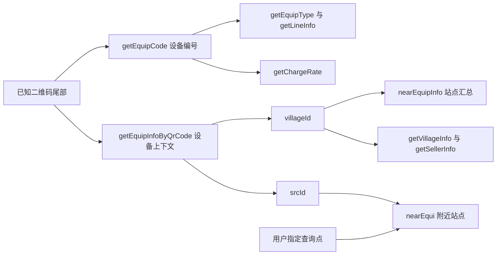

# 充电平台查询协议与 MCP 接入准备

更新：2026-10-17，北京时间。设备插座首轮实读于 10 月 15 日 23:45:41 启动；扩展接口实读发生在 10 月 16 日 00:04 至 00:12；设备清单与逐口状态继续核验至 10 月 16 日 11:59。10 月 17 日接入独立 MCP，并于 14:26 完成正式客户端实读；表内历史数量均是各次查询时的快照。

2026-10-16 的实读表明，`wx.isfdz.com` 可通过公开网页客户端的签名配置查询设备类型、插座、二维码解析、关联站点、站点汇总、计费配置及附近站点。本轮累计验证 12 条方法与路径组合，均未发送 Cookie 或 Authorization；涉及的设备、项目和站点来自用户提供的设备及其关联响应。

本文保存平台协议、验证证据与接入边界。v0.5.0 学生预览版包含独立 `charging` 来源和两项只读 MCP 工具，登录流程不变；下文带日期的数量与可达性仍只是当时快照。用户用法见 [独立充电查询](charging.md)。

完整静态目录见 [充电接口目录](charging-endpoints.json)：当前主脚本加 58 个页面及共享脚本中，共发现 86 个字面请求模板，合并固定查询串后为 85 条方法与路径组合。目录保存参数形状、12 条读取路径的观测响应结构、来源资源及摘要、调用位置和验证范围；不把静态调用存在等同于接口可用或已授权。响应中的空值与数组长度是本次样本，不是所有设备通用的必填约束或容量承诺。

## 平台入口与前端模块

| 地址或资源 | 职责 | 本次证据 |
| --- | --- | --- |
| [平台首页](https://wx.isfdz.com/) | uni-app H5 入口，加载 webpack 主脚本及按页面拆分的模块 | HTTPS 200，首页包含当前主脚本地址 |
| `/charge/enter/{code}` | 设备二维码入口 | 对 `4GR00008490` 的匿名 GET 返回 301，目标路径为同站 `/api/grant/wxAuth/enter/charge/enter/4GR00008490` |
| [主脚本](https://wx.isfdz.com/static/js/index.a7904b00.js) | API 基址、公共请求包装、客户端签名配置和页面模块清单 | HTTP 200；SHA-256 `448a40758b8df9665eb71a8793346950fddc80892fb0ade39e54f6009b233e5a` |
| [充电页面模块](https://wx.isfdz.com/static/js/pages-charge-charge.ad9eed87.js) | 设备类型、协议分支、插座列表和状态枚举 | HTTP 200；SHA-256 `2b1d8776f9737e1ebdb5813e272b21bc0ca72fdf73d30bd2f4cddb8f4111ed4d` |
| [附近站点页面模块](https://wx.isfdz.com/static/js/pages-near-near.1d99c7e0.js) | 定位、附近站点及站点汇总 | 10 月 16 日已完成关联来源及公开校区坐标下的实际读取 |

主脚本中的配置模块声明 `https://wx.isfdz.com/`，公共请求包装追加 `api/`。二维码入口与 JSON 查询接口是不同链路；状态查询实测不依赖先访问二维码入口。

10 月 16 日重新读取的主脚本 SHA-256 与上一轮相同。普通浏览器访问二维码认证跳转目标，随后得到 302，进入同站 `#/pages/message/message` 提示页面；这条跳转没有提供本次匿名 API 读取所需的站点上下文。

当前原型从首页解析 `static/js/index.<hash>.js`，再提取其中的 `app_id`、`app_secret`。后续应保留动态发现，记录资源 URL 与摘要，避免把本次构建哈希写死。凭据值只在内存使用，不写入工具参数、结果、日志或版本库。原型的六小时配置缓存是本地策略，并非平台公布的有效期。

## 请求签名

主脚本公共请求包装与成功实读一致：

1. 复制业务参数，加入整数秒级 Unix `timestamp` 和公开网页客户端的 `app_id`。
2. 对所有参数名排序；此时不包含 `sign`。
3. 依次拼接 `key=value`，参数之间不加 `&`、逗号或其他分隔符。
4. 末尾直接追加客户端 `app_secret`，按 UTF-8 计算 MD5，得到 32 位小写十六进制 `sign`。
5. GET 将参数编码到查询串；POST 将参数序列化为 JSON。签名使用编码前的参数值。

```python
data = {**params, "timestamp": int(time.time()), "app_id": app_id}
canonical = "".join(f"{key}={data[key]}" for key in sorted(data)) + app_secret
data["sign"] = hashlib.md5(canonical.encode("utf-8")).hexdigest()
```

上述 Python 形式适用于已验证的字符串及整数参数。JavaScript 对 `null`、布尔值、数组和对象的字符串转换不同，新增这类参数时需另行对齐，不能直接沿用 Python 字符串转换。

本次最小读取验证：

| 请求 | HTTP 状态 | JSON 业务状态 | 结论 |
| --- | ---: | --- | --- |
| 仅提供已知设备 `code` | 200 | `code=500`，`msg=时间戳已过期` | 缺少时间参数不能成功读取 |
| 提供 `code,timestamp,app_id`，不提供 `sign` | 200 | `code=500`，`msg=签名错误` | 当前接口检查签名 |
| 按公开前端规则提供完整签名参数 | 200 | `code=200`，设备类型为整数 `6` | 当前请求格式可用 |

HTTP 200 不等于业务成功。未验证平台允许的时间偏差窗口、其他客户端配置或签名有效期，不应从这三次读取推导这些规则。

## 已验证的读取接口

API 基址：`https://wx.isfdz.com/api/`。请求仅发送普通 User-Agent、Accept 和 `Content-Type: application/json;charset=UTF-8`；不携带用户会话。

| 方法和相对路径 | 业务参数 | 成功结构 | 验证范围 |
| --- | --- | --- | --- |
| GET `charge/mobile/getEquipType` | `code` | `{"code":200,"data":6,"msg":"…"}` | 四台设备均成功 |
| POST `equi/afterProtocol/getLineInfo` | `code,parentCode` | `{"code":200,"data":[{"num":1,"state":1}],"msg":"…"}` | 四台设备均成功，`parentCode` 为空字符串 |
| POST `equi/beforeProtocol/getLineInfo` | `code,parentCode` | 充电页面按同一插座列表处理 | 公开前端代码确认；本次没有适用设备实读样本 |

三类请求都额外包含 `timestamp,app_id,sign`。POST 使用 JSON body，不能误用表单编码。

充电页面的设备类型映射为：

| 设备类型 | 协议分支 |
| --- | --- |
| `2,6,8,10,11,12,13,14` | `afterProtocol` |
| `1,4,7,3,5,9` | `beforeProtocol` |
| 其他值 | 未确认支持，显式返回不支持的类型 |

四台已知设备都返回类型 `6`。枚举来自前端静态代码，不能据此宣称其他类型已完成实机验证。

`parentCode=""` 是本次四台设备可用的输入。完整充电页面从账户相关的 `getEquipPurseInfo` 响应读取 `parentCode`，再传给插座接口；因此新设备是否同样允许空值需要逐台验证，不能把钱包接口引入匿名状态读取来补字段。

插座响应本次只有整数 `num` 和 `state` 两个字段，编号均为 `1…20`。没有设备在线标识、功率、硬件上报时间或物理车位信息。MCP 中的采集时间应标识本机成功读取时间，不能冒充设备上报时间；返回空闲也不能证明现场有停车位置。

## 新增读取接口与站点关联

下表均于 10 月 16 日获得 HTTP 200、业务 `code=200`。业务参数之外仍需加入统一签名参数。空 `rows` 或空 `data` 的接口单独说明，不能宣称取得了实际正文。

| 方法和相对路径 | 业务参数 | 本次返回与用途 |
| --- | --- | --- |
| GET `charge/mobile/getEquipCode` | `qrCode` | `data` 为字符串；已知二维码尾部解析回 `4GR00008490` |
| GET `admin/mobile/getEquipInfoByQrCode` | `qrCode` | `data` 为设备对象；包含设备类型、总口数及 `srcId,projectId,villageId` |
| GET `admin/mobile/getVillageInfo` | `villageId` | `data` 含站点与项目名称、ID、服务电话字段 |
| GET `charge/mobile/getSellerInfo` | `villageId` | `data` 含充值、月卡、临时充电等开关及关联配置 ID |
| POST `charge/mobile/getChargeRate` | `code` | `data` 为计费配置；本次设备 `feeModel=1`，有三个功率档位 |
| GET `charge/mobile/nearEquipInfo` | `villageId` | `data` 为设备数、总插座数、占用数、空闲数与站点地址 |
| GET `charge/mobile/nearEqui` | `longitude,latitude,srcId,distance` | 顶层 `rows,total`；桑浦山示例返回一个站点 |
| GET `charge/mobile/getIsOpenActive` | `projectId` | `data` 含 `isOpenActive,isOpenCardActive` |
| GET `charge/mobile/questionList` | `srcId` | 顶层 `rows,total`；关联来源本次返回空列表 |
| GET `charge/mobile/disclaimer` | `srcId` | 关联来源本次 `data=null`；前端原本从 `data.description` 取 HTML |

二维码解析要复用实际页面的输入约定：读取允许主机的 `enter/` 路径尾部，先分离可能的 `-插座号` 后缀，再将设备二维码部分作为 `qrCode` 传入。平台前端没有把完整 URL 直接传给上述两个解析接口。本次验证的是无插座后缀的已知二维码；未验证其他厂商编码或所有二维码格式。

已知设备 `4GR00008490` 的详情返回 `projectId=3798`、`villageId=3798`、`srcId=2077`，项目及站点名称均为“汕大电动单车充电桩”。这些是响应中的关联标识，后续应沿链路传递，不能把设备编号转成站点 ID，也不能假定项目和站点 ID 永远相同。



设备详情响应还带有 `createUser,updateUser,sellerId` 等后台实体字段和版本字段；MCP 应按功能挑选必要字段，避免原样返回整个对象。`getEquipInfoByQrCode` 的路径虽然含 `admin`，这次仍可匿名读取；路径前缀不能替代实际用途与认证验证。

## 计费配置结构

`getChargeRate` 使用 JSON POST，只需设备 `code` 和统一签名参数。本次只验证一台设备的计费配置，不据此推断其他设备收费相同。

| 字段 | 平台页面的用法 | 本次证据 |
| --- | --- | --- |
| `feeModel=1` | 按 `chargeRateList[].power` 分功率段；`amount` 显示为元/小时，临时方式改用 `tempAmount` | 实读与页面模板一致，有三个档位 |
| `feeModel=2` | 页面使用电费、服务费及对应临时费字段，单位按页面模型展示 | 仅静态代码分支 |
| `feeModel=3` | `chargeTplPvAmount` 提供尖高平谷费率；`chargeTplPvTimes` 提供时间段，页面组合电费与服务费 | 仅静态代码分支 |
| `chargeTimesList[].times` | 页面生成按小时显示的时间选项 | 本次列表有三项 |
| `isOpenFullStop,cardOnceTimes` | 页面据此构造“充满自停”选项及默认时间 | 字段实读，行为来自前端代码 |

返回中同时存在名称相近的 `minAmount` 和 `miniAmount`，本次前者为空、后者为数值，不能猜测它们可互相替代。费率配置也不等于一笔实际订单的应付金额；订单方式、功率档位及其他服务配置会参与完整业务流程。

计费列表同样带创建和维护人员字段，后续只提取费率、单位、档位与配置说明。将来支持模型 2 或 3 时需补相应真实样本，不能只用模型 1 的样本验证全部计费模型。

## 插座状态定义与原型差异

当前充电页面 `socketType` 的完整枚举如下。实读只出现了 `1` 和 `2`，故障状态含义来自平台前端定义。

| 原始状态码 | 当前平台文案 | 原型文案 |
| ---: | --- | --- |
| 0 | 粘连故障 | 粘连故障 |
| 1 | 空闲 | 空闲 |
| 2 | 占用 | 占用 |
| 3 | 开路故障 | 短路保护 |
| 4 | 设备急停 | 设备暂停 |
| 5 | 过温保护 | 高温保护 |
| 6 | 烟感报警 | 过流保护 |
| 7 | 过压故障 | 过压保护 |
| 8 | 欠压故障 | 欠压保护 |

后续适配器按当前平台枚举展示，保留原始 `state`；枚举之外的值标为未知。尤其不能继续把状态 `3` 解释为短路、`6` 解释为过流。

## 真实读取快照

2026-10-15 23:45:41 起顺序读取四台设备，约六秒完成；每台各一次类型 GET 和插座 POST。没有 Cookie、Authorization、`fansId` 或 `srcId`。以下空位数不表示当前状态。

| 设备 | 类型 | 协议 | 插座数 | 当次空闲 | 当次占用 |
| --- | ---: | --- | ---: | ---: | ---: |
| `4GR00008490` | 6 | afterProtocol | 20 | 4 | 16 |
| `4GR00008485` | 6 | afterProtocol | 20 | 15 | 5 |
| `4GR00008489` | 6 | afterProtocol | 20 | 0 | 20 |
| `4GR00008492` | 6 | afterProtocol | 20 | 1 | 19 |

脱敏的资源摘要、HTTP/业务状态、字段类型与采集时间保存在本机忽略目录 `output/charging-research/static-evidence.json` 和 `live-evidence.json`。公开脚本原文也只保留在该忽略目录，其中包含网页客户端签名配置，不随仓库分发。

本机默认代理指向不可连接的本地端口，Python 原型直接使用环境代理时连接失败；禁用环境代理的 HTTPS 直连成功。既有 STU MCP 的 HTTP 客户端使用 `trust_env=False`，接入时应保持相同的明确传输行为。

## 附近站点与汇总结果

`nearEqui` 是按位置及来源上下文查询站点的接口。`srcId` 可从已知设备详情取得，本次为空时业务返回“公众号厂家id不能为空！！！”。省略经纬度则返回“参数不能为空！！！”。两种情况都是 HTTP 200 内的业务 `500`，不能当作空站点列表。

平台微信定位明确请求 `gcj02`。本轮使用公开地图上的校区位置作为查询点，没有读取用户定位；`distance=10000` 沿用平台页面默认值。以[桑浦山校区公开位置](https://www.amap.com/place/B02F2003DC)查询返回一个站点，以[东海岸校区公交站公开位置](https://www.amap.com/place/BV09055211)查询返回空列表。后者仅说明该来源与这次参数下没有返回站点，不证明东海岸校区没有充电设施。

桑浦山查询点为 `latitude=23.413846,longitude=116.631246`。返回的站点坐标为字符串 `23.416375868055557,116.63136745876736`，距离字段为 `282.0`，地址为“明德书院 MD-1”，`villageId=3798`。这些是平台汇总记录的位置字段；后续确认同组设备名称分布于多处书院、图书馆等地点，不能把该坐标或地址当作每台设备的位置，也不能仅凭“明德书院”名称判断校区。

两层响应的字段并不相同：

| 接口与字段 | 本次值或类型 | 解释 |
| --- | --- | --- |
| `nearEqui.rows[].villageId,villageName,address,latitude,longitude,distance` | 站点身份、位置与距离；经纬度为字符串 | 可用于附近站点发现 |
| `nearEqui.rows[].totalLines` | `300` | 站点容量字段 |
| `nearEqui.rows[].code` | `null` | 不能据此拿到站点全部设备编号 |
| `nearEqui.rows[].free,charging` | 都为 `null` | 不能把空值解释为零空闲或零占用 |
| `nearEquipInfo.data.equiCount,lineCount,ingCount,freeCount` | 均为整数 | 站点级设备数及插座汇总 |

2026-10-16 00:10:18 的站点详情为 `equiCount=15,lineCount=300,ingCount=230,freeCount=70`。这是平台的站点汇总，容量字段大于原型四台设备的 80 个插座；该响应不含设备编号清单，不能据此确认现场当前存在 15 台独立设备，也没有全校覆盖证明。

`villageList(fansId[,villageName])` 则是用户关联站点列表，前端使用登录身份；本次仅做静态核对，没有以空身份或猜测身份读取。匿名附近查询不需要借用这条用户接口。

## 设备清单与逐口状态核对

10 月 16 日 11:50 至 11:59，平台汇总仍为 15 台、300 口。已确认 14 台编号与 280 口容量；其中 13 台成功返回各 20 个插座，实际取得 260 口状态。平台汇总与已核验清单存在数值差异，原因尚不明确，不能据此认定现场还缺一台设备。

已确认设备的名称分布为：思源书院 4 台、图书馆 3 台、运动场中路 2 台，另有至诚书院、敬一书院、文南楼下架空层、明德书院、水电中心各 1 台。最初四台均为思源书院设备，并非明德书院设备；平台汇总地址与逐台设备名称需要分开保存。

编号发现使用已验证的公开二维码详情查询，核对已知编号相邻的有限批次 `4GR00008449…4GR00008528`，只保留响应确认 `villageId=3798` 的设备。14 条结果还都匹配项目 `3798` 和来源 `2077`。这不是从管理端导出的权威设备清单；没有在该范围找到的编号不能据此判定不存在，也不把相邻编号直接当作同组设备。

管理网页公开脚本给出的正常清单入口为 GET `https://admin.isfdz.com/api/admin/equipment/list`，参数为 `projectId,villageId,pageNum,pageSize`。本次仅用已知项目、站点及一页 20 条进行匿名读取，得到 HTTP 200 内的业务 `401`。该管理端使用 Bearer 会话，与移动网页的公开客户端签名是两条认证链路。本次没有取得管理清单。

逐口采集发生在 11:57:43 至 11:57:55。成功取得的 260 口中，平台标记空闲 80、占用 178、其他 2；这两口均为状态 `3` 开路故障，分别是文南设备 `4GR00008484` 的 17 号口、图书馆 TSG-1 设备 `4GR00008495` 的 07 号口。

水电中心设备 `4GR00008477` 的类型查询仍成功返回 `6`，但插座接口两次返回业务 `500`、提示“设备不在线”，未返回插座列表。第二次在 11:59:37 复核，与首次间隔超过 60 秒。该设备的 20 口状态未知，不能填为空闲、占用或零空闲；设备类型可读也不能证明设备在线。

已确认清单中，水电中心一台设备离线，其 20 口状态未知。清单的 14 台、280 口与平台汇总的 15 台、300 口另有统计差异，但这不是已证实的另一台实体设备或额外 20 个插座。平台汇总不能补出任何未取得的逐口状态，采集前后的占用和空闲汇总也不能当作同一时刻的插座快照。

本机忽略目录 `output/charging-research/` 中保留：`station-3798-devices.json` 为已确认的 14 台编号及名称；`station-3798-ports.json` 为逐台时间、原始状态码、状态文案与明确的覆盖范围；`station-3798-ports.md` 为可读的全部逐口快照。离线设备的 `ports` 与 `counts` 均为空值，避免失败被误读成零空闲。这些现场快照不作为自动化测试夹具或随仓库分发。

后续 MCP 以已确认的 14 台设备为基础，并分别返回已核验清单和平台汇总的来源、时间与覆盖标记；日常查询不重复相邻批次核对。新增设备须有可验证的目录或二维码等证据，不为凑齐平台汇总数继续猜测编号。历史快照中有关“第 15 台”或“缺一台”的表述只表示当时与汇总数的差值，不作为实体设备存在的证据。

## 其他业务接口的静态边界

完整目录还记录了以下调用形状，均未进行账户业务实读：

| 方法和相对路径 | 页面参数或关联关系 | 范围 |
| --- | --- | --- |
| GET `charge/mobile/chargeOrderIng` | `fansId,projectId` | 用户进行中的订单 |
| GET `charge/mobile/chargeOrderList` | 不同页面传 `fansId,projectId,month`，另有分页、钱包、月卡或卡号筛选 | 用户订单列表，参数形状见目录 |
| GET `charge/mobile/chargeOrderInfo` | `orderNum,month` | 单笔订单详情 |
| GET `charge/mobile/getPowerList` | `orderNum,month` | 订单功率曲线；页面使用返回的 `createTime,power` |
| POST `charge/mobile/getEquipPurseInfo` | `code,fansId,srcId` | 账户钱包及设备业务上下文 |
| POST `grant/wxParams/getWxConfig` | `srcId,clientUrl` | 微信网页 SDK 配置；与 API 请求签名不同 |

订单详情和功率页面把 `month` 去掉连字符后发送。订单标识、用户身份和 SDK 令牌都没有通过本次匿名站点查询获得，也不从前端路径存在推导账户访问能力。

特别注意，`bindCard`、`bindProCard`、`unbindCard` 在前端使用 GET，但用途是绑定或解绑；`getSecretCode` 返回充电流程验证码。这些不能因为名称含 get 或方法是 GET 就放进只读 MCP。目录中的未验证分类是静态业务判断，不是权限测试结果。

## 状态查询的请求范围

现有原型客户端仅允许类型查询与两个 `getLineInfo` 路径。完整充电页面在读取插座列表后还调用 `charge/mobile/sendLineState`，其回调日志为“故障存储成功”；这属于状态上报，读取适配器应省略。`equi/beforeProtocol/checkLine` 连接充电前检测流程，也不纳入只读查询。

开始或停止充电、钱包、订单、支付、定位上报和订阅功能不属于这次核验的读取合同。后续客户端可按具体功能扩展至本次验证的二维码、站点、费率等读取路径；请求采用逐条白名单，不以 `admin` 或 `charge/mobile` 整个前缀、HTTP 方法统一放行。

## 独立 MCP 实现

本节描述 v0.5.0 学生预览版的独立实现；日期相关的真实读取证据保留原观察范围。

STU MCP 的充电能力独立运行：用户的 agent 通过本地 stdio MCP 调用充电工具，MCP 内的充电客户端直接请求 `wx.isfdz.com`，在本机处理签名、设备清单、缓存和状态归一化。用户提供的 `campus-charge` 网页项目仅用于参考平台协议与实现原理；不把该网页、自建 HTTP API、腾讯云服务器或自有域名作为安装、查询或发布的依赖。

`charging` 来源没有用户登录会话依赖。公开网页客户端的请求配置由本机充电客户端读取并在进程内缓存，配置值不进入 MCP 参数、结果或客户端配置；采集按需执行，不安装独立网站或后台采集服务。

工具为 `get_charging_overview(location="", limit=4, offset=0, refresh=true)` 和 `get_charging_device(device_code, refresh=true)`：总览按位置名称或别名筛选，分页返回设备状态摘要；详情返回一台设备的全部已取得插座。一次总览最多读取四台设备，详情只读取一台，均按设备缓存至少 60 秒，并通过本机持久租约去重同设备的并发请求。`refresh=true` 仍遵守最小刷新间隔。设备编号来自已确认清单，不接受任意用户 URL；若后续支持二维码输入，只从允许主机的二维码路径提取编号。

扩展研究支持增加两类独立能力：通过已知设备解析站点后读取站点汇总及计费配置；在用户指定的查询点及已确认的来源上下文内查询附近站点。设备详情中的关联标识可在本机缓存，但动态发现优先于硬编码。站点汇总和设备插座各保留自己的采集时间，不能把两次读取当作同一硬件快照。

60 秒是原型的保守本地策略；未发现或测出平台承诺的限频值。平台返回 429 时停止本轮并遵守合法 Retry-After，不以密集试探来测限。

每台结果包含原始设备编号、平台入口、设备类型、插座原始状态及统计、`collected_at`、`last_attempt_at`、`cached`、`stale` 和结构化错误。查询失败时保留上次成功数据和原采集时间；没有成功样本时插座与统计为 `null`。总览合计排除已过期或最新尝试失败的旧样本，对应容量计入未知；没有可用于当前统计的样本时合计为 `null`。平台没有提供的硬件时间与在线状态保持未知，仅在明确报告设备离线时返回 `online=false`。

模块边界如下：

| 位置 | 接入要求 |
| --- | --- |
| `sources.py` | 独立第三方来源和唯一允许主机，无用户会话；与学校官方来源分开 |
| `features/charging/` | 契约、纯解析、公开配置发现、签名、逐条路径白名单、JSON POST 与业务服务；不沿用学校的表单 POST 客户端 |
| `charging.py` | 保留现有导入接口的兼容入口，核心实现归 `features/charging/` |
| `charging_devices.py` | 14 台已核验设备的公开编号、位置、别名和清单核验日期；没有历史插座状态 |
| `charging_cache.py` | SQLite 快照、60 秒最小刷新间隔、进程间租约和来源冷却；失败保留旧样本 |
| `app.py` | 独立充电方法；`refresh_source("charging")` 提示使用专用工具，不落入雨课堂分支 |
| `server.py` / `cli.py` | 两项只读 MCP 工具和 `charging overview/device` CLI，返回状态与时间，由调用方 agent 判断 |

业务失败要同时检查 HTTP 状态、JSON `code` 和数据结构。签名错误、时间戳错误、权限拒绝、限流、网络失败和结构变化分开反馈；平台的业务 `500` 不能一律解释为需要用户登录。签名配置失效最多刷新公开配置并有界重试，不能启动循环认证。

合成测试覆盖签名排序和空 `parentCode`、两个协议分支、未知状态、重复或非法插座编号、HTTP 200 内的业务失败、缓存与部分失败、重定向拒绝、Cookie 隔离及配置值不外泄。真实读取只验证到现有清单的 `afterProtocol` 类型 6，`beforeProtocol` 尚无实机样本。

10 月 16 日本地 stdio 测试曾在 `client.initialize()` 超时；10 月 17 日改动前基线及接入两项工具后的真实子进程测试均已通过，没有据此推断此前超时的根因。10 月 17 日首次实读发现首页使用未加引号的脚本地址，客户端已改用 HTML 解析器并加入回归；失败记录保留在忽略目录。

10 月 17 日 14:26:09 至 14:26:20，正式客户端从本机独立发出 30 次请求，分页读取 14 台已核验设备：13 台返回 260 个插座状态，水电中心 `4GR00008477` 报告离线。随后同设备详情命中本机缓存，没有追加上游请求。报告只记录路径、状态和规范化公开数据，保存在忽略目录 `output/charging-research/mcp-live-20261017-verified.json`，没有写入签名配置或签名 URL。完整工程验证见 [验证记录](verification.md)。
