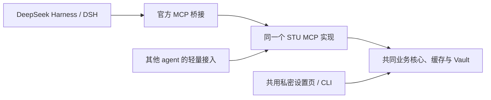

# DeepSeek Harness 接入与低维护成本方案

决策日期：2026-10-28。状态：**轻量接入与可选原生薄插件已实现；真实桥接、桌面对话、侧栏与安装管理条目已验证；真人登录后读取仍待验收**。

名称统一使用 **DeepSeek Harness** 或 **DSH**。DSH 是 agent 运行时与框架，不能把整个 DSH 简化称为一个客户端；本文的“MCP 客户端”专指它内部连接 MCP 服务的组件，“桌面端”专指其桌面应用。

## 已确定的架构

**一份业务实现、一个 MCP、一套共用设置流程，加上很轻的客户端接入。**

校园协议、认证、缓存、来源状态及业务规则只在 STU MCP 的 Python 核心实现一次。
DSH 通过官方 MCP 桥接接入，其他 agent 通过各自的 MCP 支持接入同一服务实现。
CLI 与私密设置页共用认证和配置核心，登录流程不随 agent 分叉。

“一个 MCP”指同一套服务实现和工具契约，不要求不同电脑、用户或本机 stdio 连接强行共用一个进程。
个人服务器继续遵循既有单用户 HTTP 实例边界。

随后用户指出侧栏与安装列表缺少 STU MCP 入口，当前范围增加可选薄插件 `dsh-stu-mcp`。
该插件仅负责安装管理条目、侧栏状态与共用设置入口；不包含专属课表页面、第二套登录表单或按宿主版本分叉的业务包。
功能目录来自同一个 MCP 的能力投影，界面只调用既有 `get_capabilities` 与 `open_setup`。

## 维护职责

| 层次 | 维护内容 | 变更影响 |
| --- | --- | --- |
| 业务核心 | 学校接口、来源解析、认证、缓存和状态语义 | 修复一次，所有接入方受益 |
| MCP 契约 | 工具名、参数、结构化结果、错误说明和使用指引 | 统一发布、统一回归，保持旧调用兼容 |
| 共用设置 | 既有私密设置页、CLI、配置状态与登录引导 | 各 agent 使用同一流程，不复制页面和认证逻辑 |
| 轻量接入 | 启动命令、配置位置、格式、幂等合并和连接验证 | 某个接入方格式变化时，仅调整其配置适配 |

优先扩展现有 `clients.py` 中的配置描述和少量差异处理。DSH 可选薄插件使用宿主 React 与 Slots，直接分发 JavaScript，不增加通用插件框架、独立前端构建链或其他 agent 的发行包。
同一源码主线发布 STU MCP；配置导出从共同安装信息生成。记录已验证的 DSH 版本和接入环境，不为每个宿主版本维护分支。

## 先改善哪些体验

1. **接入验证**：明确区分安装完成、配置已写入、工具已发现和实际调用成功。以真实调用 `get_capabilities` 验证接通。
2. **共用配置引导**：根据 `login_flows`、宿主位置和交互能力，引导本人使用现有私密设置页或 CLI。统一当前 instructions 中偏向 CLI 的旧表述。
3. **结果状态**：所有 agent 使用相同的 `ok`、`status`、来源、采集时间、覆盖范围和部分失败信息。协议调用完成不等于业务成功。
4. **连接可靠性**：验证 DSH 官方桥接下的启动探测、慢刷新、取消、重连和重载，再依据实测调整接入参数。配置调整不能代替服务端的执行预算。
5. **跨 agent 回归**：共同协议契约测试加少量各接入方的实际调用测试；业务逻辑不在每个 agent 中重复实现和维护。

完成标准是用户能够完成“接通 → 公开查询 → 按需配置 → 查询本人信息”，每一步都能区分成功、未配置和失败。已有用户升级保留配置及工具身份。

## 已核对的官方依据

以下事实来自 2026-10-28 的官方文档核对，上游文档不等同于用户实际安装版本。

- DSH 的官方 `@deepseek-ai/dsh-mcp-client` 支持 stdio 和 Streamable HTTP、服务器指引及结构化结果，可直接连接现有 MCP。
  默认单次工具调用预算为 60 秒，stdio 协商会先启动探测进程。见[官方 MCP 桥接说明](https://github.com/deepseek-ai/deepseek-harness/blob/master/packages/mcp/mcp-client/README.zh.md)。
- DSH 桌面应用拥有自己的 `desktop` profile 和随应用提供的 runtime；桌面插件管理与另一份 npm CLI 的安装环境有边界。
  现有接入应保留这一边界，见[Desktop runtime](https://github.com/deepseek-ai/deepseek-harness/blob/master/apps/desktop/README.md#bundled-command-runtime)。
- 官方支持原生组合包及 UI 扩展；薄插件按已实测版本声明兼容性。
  参考[组合包](https://deepseek-harness.github.io/deepseek-harness/develop/basic/publish)与[Slots](https://deepseek-harness.github.io/deepseek-harness/reference/subsystems/slots)。

## 现有实现与兼容边界

- [clients.py](../src/stu_mcp/clients.py) 已提供配置预览、备份、合并、幂等和冲突检测，DSH 桌面接入使用既有 profile patch。
- [server.py](../src/stu_mcp/server.py)、[HostRuntime](../src/stu_mcp/hosting.py) 和[能力目录](../src/stu_mcp/capability_catalog.py) 共用工具、宿主状态和配置引导。
- 保留原始工具名、参数默认值及已发布结果字段；新增字段优先使用可选项。保持稳定的 `serverName: stu-mcp`，同一接入作用域避免重复注册。
- 保留 stdio、个人服务器 HTTP、CLI 和可选 Skill；共同流程不要求先安装 Skill。账号配置、业务状态和宿主执行位置继续准确区分。
- 登录数据继续进入既有私密流程；报修完整预览、确认和单次提交约束继续由共同业务核心执行。
- 私有 School Hub 是另一项目，不纳入本次公开 STU MCP 改动。

## 验证记录与待办

最初调研源码基线为 `4c6a2b8547ceb1f4d90442f1e0c074a82db18b30`。
该轮 `uv run --extra dev pytest` 为 **2539 passed、4 skipped**，`uv run --extra dev ruff check .` 通过。
这是此前已执行的仓库基线检查；本次架构决策修订仅修改文档，不把旧结果称为 DSH 应用内验收。

后续实施需验证：

| 验收面 | 证据 |
| --- | --- |
| 通用 MCP | stdio / HTTP 工具契约、结构化结果、失败与缺登录状态一致 |
| DSH 接入 | 记录版本，真实发现和调用工具，检查重连、取消、慢请求及重载 |
| 配置维护 | 备份、幂等、升级后路径更新、禁用状态保留和冲突处理 |
| 共用设置 | 本机网页与 CLI 均可用，远程宿主引导准确；合成测试与真人登录分别记录 |
| 其他 agent | 既有配置回归和代表性实际调用，不用配置写入成功代替接通证明 |

此前 shell 未找到 `dsh` 命令，仅表示该 PATH 中不可用，不证明桌面应用未安装。
最初调研和首轮实施未修改用户客户端配置；随后按用户要求完成桌面对话验收，
通过 `connect dsh --apply` 备份并合并桌面 profile。当时没有安装自有 DSH 插件；随后侧栏实施另见下节，没有发布新版本。

## 首轮实施

- `connect dsh` 与原 `connect deepseek-harness` 共用实现；可用 `--profile` 显式选择已初始化环境，默认仍为桌面端。
- 新增通用 `verify` 命令，检查当前安装的 MCP 握手、工具发现与状态调用。仅输出检查摘要，明确不等于 agent 已加载。
- 共用服务器指引已统一网页 / CLI 认证选择和业务结果判读，无新增 DSH 专属业务或界面。
- 已用安装于本机的 DSH `0.2.1-rc.3` 真实桥接与注册表验证 52 个工具和连接重建。没有调用模型或加载用户桌面 profile。

命令、验证边界与脚本入口见[接入说明](clients.md#deepseek-harness-桌面端)。

实施后的全量回归：`uv run --extra dev pytest` 为 **2552 passed、4 skipped**；
`uv run --extra dev ruff check .` 通过。新增 `verify` 命令也已通过隔离数据目录的实际 CLI 调用。

## 桌面对话验收

2026-10-28 在本机 DSH `0.2.1-rc.3`、DeepSeek-V4.1-Flash（1017，Max）中完成四轮对话：
公开通知查询、缺登录与共用设置页、正文失败识别、修复并重启后的正文实读。
实测发现学生处 `News.aspx` 正文容器未适配，已在共用解析器修复；工具契约和其他 agent 的入口不变。
公开来源仍有四个栏目在当时网络中直连超时，不能称全站读取成功。
真人输入凭据、登录后个人数据、取消慢请求和热重载没有在这次桌面对话中验收。
完整调用、失败和恢复证据见[桌面验收记录](verification/2026-10-28-dsh-desktop.md)。
正文修复后的全量回归为 **2565 passed、4 skipped**，Ruff 检查通过。

## 可选原生薄插件

源码与本地安装说明见 [integrations/dsh](../integrations/dsh/README.md)。包名 `dsh-stu-mcp`，
本轮版本 `0.1.0`，兼容范围暂锁定已实测的 DSH `0.2.1-rc.3`。

- 左侧 STU MCP 面板、右侧 STU MCP 标签、插件详情共用同一个组件。
- 首页简要说明公开查询和四项常用账号；每行只显示用途与状态。WebVPN、外卖及维护工具默认折叠，版本、工具数量和连接说明收进“连接信息”。账号状态继续来自共同能力目录。
- 设置按钮调用现有 `open_setup`，不在 DSH 内收集凭据，也不返回私密设置链接。
- Host 通过既有工具注册表调用官方 MCP 桥接，不注册重复工具、不启动第二份 MCP。
- 两个固定操作通过 DSH 自带认证 Connection/Gateway 的 source-mode Remote 接口传输。
- 停用或卸载这个 UI 包只移除界面；由 `connect dsh` 单独配置的 MCP 连接仍可供对话使用。
- v0.7.4 通过 GitHub Release 分发插件安装包，尚未上架 npm 或 DSH 公共插件目录；早期本机安装验收保留原时点说明。

具体检查与边界见[插件侧栏验收](verification/2026-10-28-dsh-plugin.md)。
