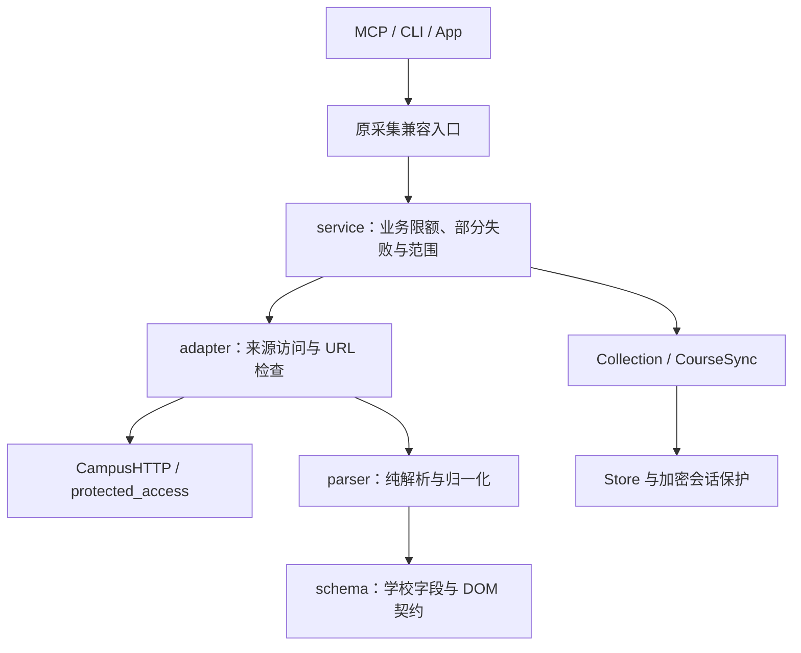

# 来源适配与维护

本文维护各来源共用的依赖方向、数据完整性和改版步骤；模块总览见[架构](architecture.md)，具体使用方法见各功能文档，历次迁移及兼容比对见[验证归档](verification/2026-10-20-adapters.md)。公开 `stu-mcp` 与 Hermes 私有 `school_hub` 的部署和凭据独立。

## 文件职责

| 层 | 放什么 | 不放什么 |
| --- | --- | --- |
| `schema.py` | 已观察的 URL、字段、DOM、枚举与协议常量 | 猜测性备用接口、凭据或个人样本 |
| `parser.py` | 原始 HTML/JSON 到内部记录、身份与类型校验 | 网络、浏览器、Store 或重试 |
| `adapter.py` | 固定访问、传输预算、受保护读取及解析调用 | 缓存清理、工具描述或跨来源调度 |
| `service.py` | 范围、请求限额、部分失败与可替换快照 | 页面选择器、随意转换原始字段 |
| 共用模块 | `parsing` 纯函数、`collection` 结果类型、`pagination` 完整性判定 | 反向依赖具体功能包 |
| 兼容门面 | `parsers` / `collectors` 等旧导入、参数及依赖注入转发 | 第二份解析或业务实现 |

`features/notices`、`mystu`、`jw`、`yuketang`、`charging`、`huyou` 遵循该边界；报修还将一次提交与回执读取分开，见[报修架构](architecture.md#报修模块的分层)。纯狐友缓存合并不导入 Store/App。功能包不反向依赖兼容门面；认证、密钥库、数据库和签到后台不为统一目录机械重写。

## 容许变化与停止条件

| 读取场景 | 可兼容 | 明确停止或部分失败 |
| --- | --- | --- |
| OA 列表 | 明确表头下换序、增列和外层包装；已知单格/三列旧布局；匿名列表同页登录框 | 关键列缺失/重复、通知身份或内容冲突、未知旧布局；只有搜索框不足以证明空列表 |
| 官网服务目录 | 保留 class 契约的 section/div 或包装变化 | 无法识别目录/入口，不伪装空目录 |
| 通知正文 | 已识别容器包装、main、附件型文章、OA 独立附件区 | 登录/错误/维护页、未知模板、多候选正文或歧义附件 ID；不回退到整页导航 |
| MySTU 数组记录 | 列换序、增字段；对象记录增可选字段 | 重复列、宽度不匹配、关键类型变化或重复身份；布尔不能当年份/学期/身份/标题 |
| ELC 课程与详情 | 包装、已知表格/定义列表顺序、嵌套说明容器、正常无截止日期 | 缺链接/标题、重复身份/截止字段、未知详情或登录页；描述文字不冒充截止字段 |
| 教务成绩与考试 | 增列/换序/空白、已知别名、布局表格、相同重复/后置表头、明确统计/空行 | 多候选表、同义列冲突、合并歧义、坏行宽、ID 冲突或无效选中学期；详见[教务](academic.md) |
| 雨课堂 | 增字段、键换序；保留原生学期和既有 ID/URL | 列表改名/缺失、类型漂移、布尔/重复身份、公告无稳定 ID；详见[雨课堂](yuketang.md) |
| 充电 | 主脚本 hash/包装/相对链接、唯一配置普通额外字段、未知整数状态 | 多候选/动态或交叉配置、成功信封缺数据、坏身份/类型；详见[第三方](third-party-adapters.md) |
| 狐友 | 额外字段、明确非帖子/已删除记录、正常空内容、有界部分读取 | 坏正文/身份/分页/回复不能当完整空结果；详见[第三方](third-party-adapters.md) |

## 数据与失败语义

查询默认使用缓存，刷新按用户或 agent 请求运行。记录保留 `source` / `collected_at`，刷新说明 `coverage`、`limited`、`errors` 和来源时间。有界的近期栏目、OA 首页和最新学期库存不声称覆盖全部学校信息；失败保留未能确认替换的旧数据，不用刷新时间冒充成功采集时间。

通知列表只更新列表字段。同一 URL 和访问范围可保留旧正文、附件与独立 `detail_collected_at`；重新读正文才可替换或清空详情。认证/匿名范围或 URL 改变时不沿用旧详情，避免受保护内容进入公开缓存。正文失败保留原文及其旧时间。

MySTU/雨课堂课程、任务与资源携带 `course_id` / `semester`。MySTU 使用 `attendanceYear-attendanceSemester`，雨课堂保留原生学期，不能相互解释。完整库存确定最新可用学期范围，范围元数据加密保存；查询仅返回该范围。旧版缺课程/学期的缓存不猜归属，通过 `unverified_count` 提示，直到完整快照确认后才清理。

只有完整 API 课程/活动快照才可清理已确认范围：某课完整活动列表中消失的任务/资源可删除，确认完整的空列表也有效。课程上限、50条活动限制、未读分页、字段缺失或读取失败均不能授权清理未知范围。`coverage.inventory_complete`、`complete_activity_courses` 与 `course_snapshot_complete` 区分完整空结果、部分和失败。ELC HTML 可能仅含章节或延迟加载，始终不证明全部活动已读。

详情、个人日程和公告与活动完整性各自独立。`detail_status` / `due_at_status` 区分不可读和正常未设截止；详情失败不能把旧截止时间标成新读取。MySTU 作业详情或日程失败不改变已完整读取的活动范围；雨课堂活动/公告失败互不阻断，公告从不参加任务快照删除。成绩、近期通知、公告和日期窗口日程保留历史。待办本地 `status` 与学校 `school_status` 分开，待办操作不提交学校业务。

狐友公开社区帖子独立于官方通知；轻量搜索保留旧正文和讨论，只有完整讨论范围可以替换对应旧内容，部分失败逐层保留及标明。充电使用独立设备表、租约、成功/尝试时间和共享冷却；失败不覆盖上次成功样本。二者详细政策分别见[狐友](huyou.md)与[充电](charging.md)。

## 学校改版后的维护步骤

1. 用合成数据复现失败，标明页面角色和来源范围。真实账号、Cookie、ticket、成绩、个人页面不进 fixture。
2. 先写失败回归，明确旧数据应保留还是可由完整新快照替换。
3. 字段/标签变化改 `schema` / `parser`；URL/访问方式变化改 `adapter`；业务限额或部分失败政策变化才改 `service`。无证据不猜别名、接口、认证绕过或整页兜底。
4. 核对 ID、字段、缓存时间与范围清理兼容，跑完整测试、Ruff、打包和隔离安装。工具名称、参数、结果与注解以及旧 Python 入口均要核对。

来源整理不自动增加重试、保活、全量探测或可访问主机，也不改代理/DNS。接入新来源、改认证和改提交行为分别核实，不由一次目录整理附带完成。

## 为什么先改这些部分

原审查优先处理会直接影响 MCP 查询结果的 HTML/JSON/JS 解码和字段歧义：报修、官网/OA、MySTU/ELC、教务、雨课堂、充电与狐友均已分离功能包。迁移原因、当轮测试及未做真实读取的限定保留在[分层验证归档](verification/2026-10-20-adapters.md)。独立作业诊断、认证与签到后台的剩余边界见[后续审查](third-party-adapters.md#剩余重构顺序)。
